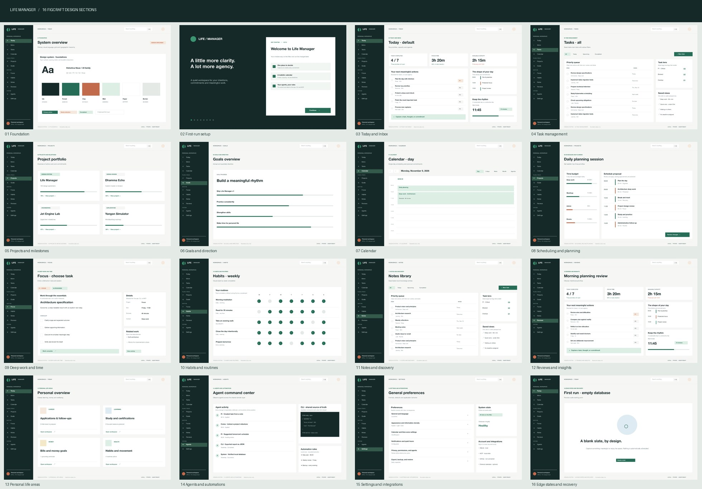

# Life Manager

A local-first personal productivity app (macOS-primary; CI also builds and tests on Linux and Windows), built natively in Rust with [GPUI](https://gpui.rs) (`crates/life-gpui`), an in-process SQLite/SQLCipher engine (`crates/life-core`), and a standalone CLI + MCP server (`crates/life-cli`). Tasks, calendar, projects, goals, focus sessions, habits, routines, notes, reviews, explainable insights, personal life domains, and agent guardrails all live in one SQLite file.

> **Status:** the build in this repository is **ad-hoc signed and not notarized**, so macOS rejects it on other Macs. See [Release](#release). There is no account, no telemetry and no server.



## What it does

- **Today** — a calm dashboard of your real priorities, your commitments and your actual remaining capacity.
- **Inbox and Tasks** — capture in one gesture, then process when you are ready. Interactive priority pills (`P1–P4`), snooze, recurrence with per-occurrence exceptions, dependencies, templates, bulk edits and reusable saved views.
- **Calendar and Planning** — day, three-day, week, month and agenda views, overdue decision triage, carryover of unfinished work, protected time windows, weekly area time budgets and deterministic schedule proposals you approve before they land.
- **Projects and Goals** — milestones, timelines, a 3-column Kanban board (click status transitions), project templates, measurable key results (OKRs) and progress tracking.
- **Focus** — live 1-second focus ring timer, stopwatch/pomodoro/manual entries, interruption reasons and trends against planned effort.
- **Habits, Routines, Notes, Reviews and Insights** — flexible cadences with no coercive streaks, repeatable ordered routine steps, editable markdown notes, daily/weekly/monthly guided reviews and explainable area/goal reports.
- **Personal life areas** — domain responsibility cards plus career pipeline, learning tracks (`+30m` session logging), financial commitments and daily wellbeing check-ins.
- **Agents and Automations** — a typed CLI and an MCP server with per-actor permissions, reviewable proposals (`Approve` / `Reject`), local automation rules, an audit trail and guarded undo.

## Run & Install

To run the native GPUI desktop app in development mode:

```bash
make dev
```

Other `Makefile` targets: `make build`, `make release`, `make test`, `make lint`, `make fmt`, `make check`, and `make validate-design`.

To build the release macOS `.app` bundle (`dist/Life Manager.app`) and standalone `dist/life` CLI binary:

```bash
make bundle
# or directly:
./scripts/release.sh build
```

The app bundle and CLI are written to `dist/`. This build is ad-hoc signed and should not be distributed. You need an Apple Developer ID certificate and notarization credentials for a build Gatekeeper will accept on other Macs. See [Release](#release) and `RELEASE_CHECKLIST.md`.

## The agent surface

```bash
life today --json
life task create --title "Prepare the review" --priority 2
life calendar propose --date 2026-05-01
life mcp serve --stdio
life mcp remote --port 0
```

The MCP catalog is generated from one table, so the CLI, the local MCP server and the remote one always offer the same tools with the same typed parameters. The tool names published by earlier releases keep working, and `crates/life-cli/tests/mcp_contract.rs` proves it.

## Your data stays yours

- One SQLite file in `~/Library/Application Support/LifeManager/`. Nothing is uploaded.
- Optional encryption at rest, with a passphrase derived through Argon2id and SQLCipher. The passphrase is never written to the database, the state file or the repository.

```bash
life db status
life db encrypt --passphrase "your passphrase"
```

- No telemetry, no crash reporting, no update check.
- See [PRIVACY.md](PRIVACY.md) and [SECURITY.md](SECURITY.md).

## Release

```bash
export LIFE_SIGN_IDENTITY="Developer ID Application: Your Name (TEAMID)"
./scripts/release.sh all
```

The script builds the CLI and the bundle, signs with the hardened runtime and a timestamp, submits to Apple for notarization, staples the ticket, writes `dist/LifeManager.dmg` and verifies the result. It stops with an explicit message when a Developer ID certificate or notarization credentials are missing, rather than producing an artifact that only looks finished.

**The build in this repository is ad-hoc signed.** `spctl` rejects it and it carries no notarization ticket, so it is not yet safe to install on another Mac. Run `./scripts/release.sh all` with a Developer ID Application certificate installed to produce a distributable build.

`RELEASE_CHECKLIST.md` is the full runbook, and `scripts/install-homebrew.sh` writes the cask.

## Build and test

```bash
cargo fmt --all -- --check
cargo clippy --workspace --all-targets -- -D warnings
cargo test --workspace --offline
python3 qa/full_e2e.py
python3 qa/figcraft_parity_e2e.py
python3 qa/v9_extensions_e2e.py
python3 qa/v11_reminders_habits_e2e.py
python3 qa/parity_v15_e2e.py
python3 qa/release_e2e.py
python3 qa/encryption_e2e.py
python3 qa/board_coverage.py
python3 design/scripts/validate_design.py
```

> Note: `qa/v9_extensions_e2e.py` and `qa/v11_reminders_habits_e2e.py` default `LIFE_CLI` to `dist/life`; the other `*_e2e.py` scripts default to `/tmp/life-manager-target/release/life` unless `LIFE_CLI` is set.

## The design system

`design/life-manager-master.figcraft` holds **224 editable boards** across 16 pages and is the source of truth for every screen. `design/scripts/tokens.py` is the token table the master and `crates/life-gpui/src/tokens.rs` are both generated from, so one change repaints both.

```bash
python3 design/scripts/build_figcraft.py     # rebuild the board JSON
python3 design/scripts/bind_tokens.py        # bind the design tokens
python3 design/scripts/rebuild_master.py     # write the native .figcraft
python3 design/scripts/render_previews.py    # export the previews and contact sheets
python3 design/scripts/validate_design.py    # the gate
```

## Documentation

| Document | Subject |
|---|---|
| [Architecture](docs/ARCHITECTURE.md) | Crate layout, SQLite concurrency, scheduling & security model |
| [Data Model](docs/DATA_MODEL.md) | Schema v16, UUIDv7 revisions, and SQLCipher encryption |
| [CLI & MCP](docs/CLI_AND_MCP.md) | Typed CLI commands, stdio & remote MCP server |
| [Test Plan](docs/TEST_PLAN.md) | Unit, contract, headless GPUI, and E2E suites |
| [Privacy](PRIVACY.md), [Security](SECURITY.md), [Support](SUPPORT.md) | Local storage, key handling, and troubleshooting |
| [Contributing](CONTRIBUTING.md), [Code of Conduct](CODE_OF_CONDUCT.md) | Development guidelines |

## Licence

MIT. See [LICENSE](LICENSE).
